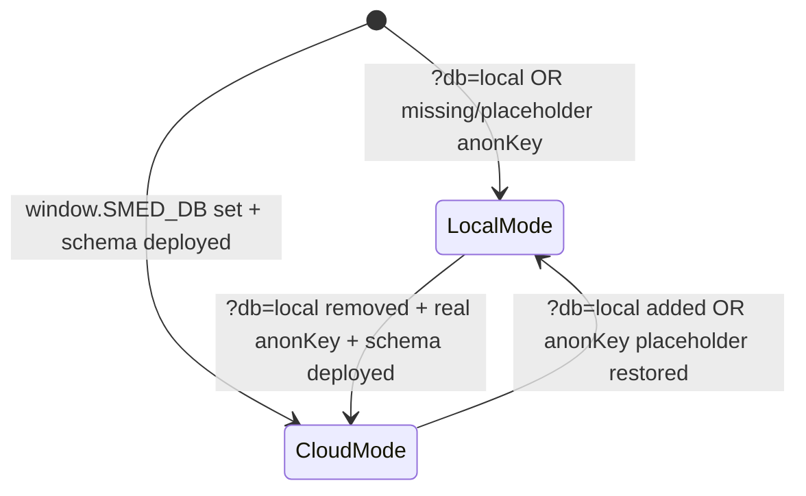

# Reference: SMED → Supabase Data Sync State

When debugging why data is (or is not) reaching Supabase, the root cause is almost always one of these states. Use this decision table to traverse the state machine.

## Data sync state decision table

| Condition (check in order) | Data location after action | Fix |
|---|---|---|
| `?db=local` in URL, or `anonKey` placeholder in `supabase-config.js` | `localStorage` only (no fetch to Supabase) | Remove `?db=local`; replace placeholder `anonKey` with real key from Supabase Dashboard → Project Settings → API → anon public |
| `supabase.min.js` not loaded, or loaded after `supabase-client.js` | `window.SMED_DB` is null → falls back to `localStorage` | Ensure `supabase.min.js` (CDN) loads **before** `supabase-client.js` |
| `window.SMED_SUPABASE` or `window.SMED_SUPABASE.anonKey` is missing/empty | `supabase-client.js` returns early (`configured=false`); no `window.SMED_DB` created | Check `window.SMED_SUPABASE` is set with valid URL + non-placeholder key |
| Schema not deployed to Supabase (`smed_docs` table missing, no `smed_patch` RPC) | `upsert()` fails with `PGRST205` / `42P01`; app falls back to `localStorage` | Run `supabase/schema.sql` in Supabase Dashboard → SQL Editor |
| RLS policies block anon writes | `invalid_argument` + `42501` on `upsert()` | Verify `public.smed_docs` policies grant `anon` `select, insert, update, delete` (pilot mode) |
| App runs in `?db=local` mode | Data written to `localStorage` only; never reaches Supabase | Open app without `?db=local` |

## Key architectural invariants

| Container | When it takes effect | Source of truth for a given `coll/id` |
|---|---|---|
| `localStorage` | `db=local` OR no valid Supabase config | Never before Supabase works |
| `window.SMED_SEED` | Only on first load into `localStorage` (when `Config.seedAt < seed.exportedAt`) | Initial seed, not live storage |
| `public.smed_docs` (Supabase) | When `window.SMED_DB` is set and schema is deployed | Authoritative; client merges via `smed_patch` RPC |

## Supabase REST API quick reference (for local verification)

| Operation | Endpoint | Expected status codes |
|---|---|---|
| List docs | `GET /rest/v1/smed_docs?select=coll,id` | 200, empty `[]` if no rows |
| Insert/upsert | `POST /rest/v1/smed_docs` with `apikey` header | 201 Created if new, 204 No Content if updated |
| RPC (smed_patch) | `POST /rest/v1/rpc/smed_patch` with body `{ p_coll, p_id, p_patch }` | 204 No Content, or `42883` if function missing |

## Data flow at a glance

